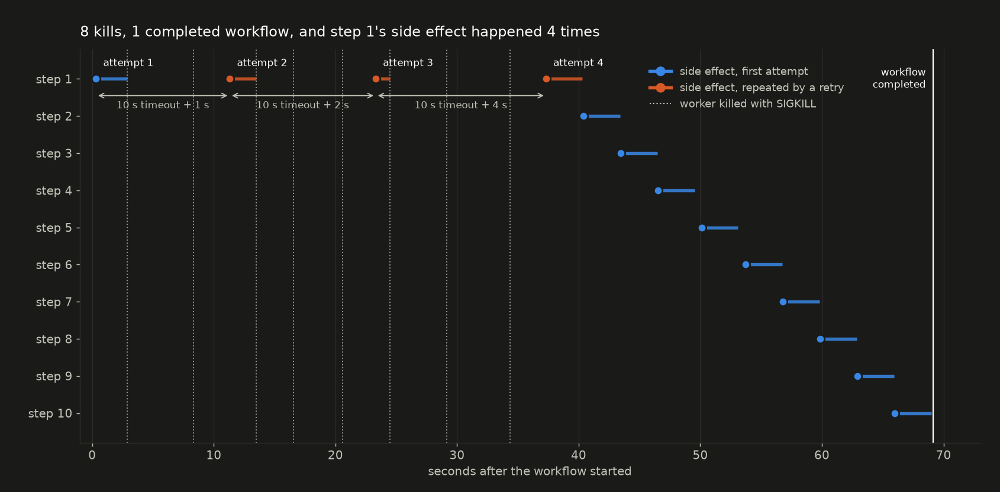
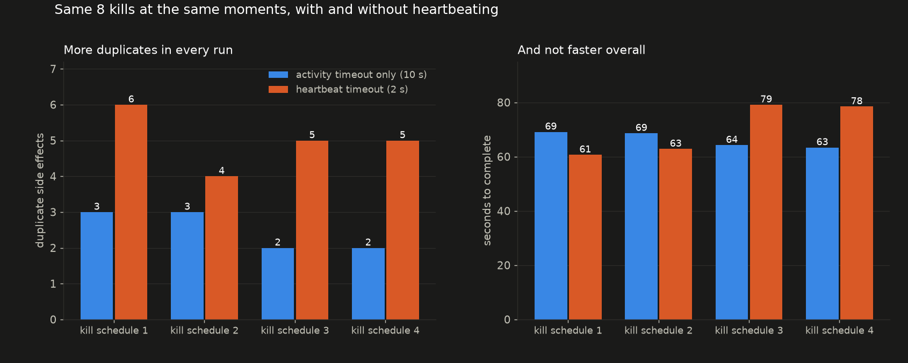

# temporal-kill-test

What a Temporal workflow does when you `kill -9` its worker over and over, and what its
determinism check actually checks. Temporal Server 1.32.0 (CLI 1.9.1 dev server), Python
SDK 1.34.0.



## Findings

- **The workflow completed exactly once, but activities are at-least-once.** Eight kills
  during a ten-step workflow: it completed once, and step 1's side effect ran four times.
- **A dead worker is invisible until a timeout expires.** The server can't see a process
  die. Retries came at exactly `start_to_close_timeout` plus the backoff: +1 s, +2 s, +4 s.
- **Heartbeating made duplicates worse.** Same kill schedules, 2 s heartbeat timeout:
  median 5 duplicate side effects against 2.5, and no faster to complete. Faster
  detection means the retry is already running when the next crash arrives.
- **An idempotency key fixes it.** `workflow_id:activity_id` is identical on every retry of
  a step. Worst case: step 1 executed six times, charged once.
- **The determinism check compares the shape, not the arguments.** Replaying a real
  history: inserting a new activity or dropping a step is rejected, but running the steps
  in reverse order, or with completely different arguments, replays cleanly.



## Reproduce

```bash
temporal server start-dev --db-filename temporal.db
python -m venv .venv && .venv/bin/pip install temporalio matplotlib
.venv/bin/python chaos.py chaos-1 8 10 1        # 8 kills, 10 s timeout, seed 1
.venv/bin/python chaos.py chaos-hb 8 10 1 2     # same kills, 2 s heartbeat timeout
IDEMPOTENT=1 .venv/bin/python chaos.py idem 8 10 3 2
.venv/bin/python replay.py                      # no server needed: reads data/chaos-1-history.json
```

MIT licensed.
